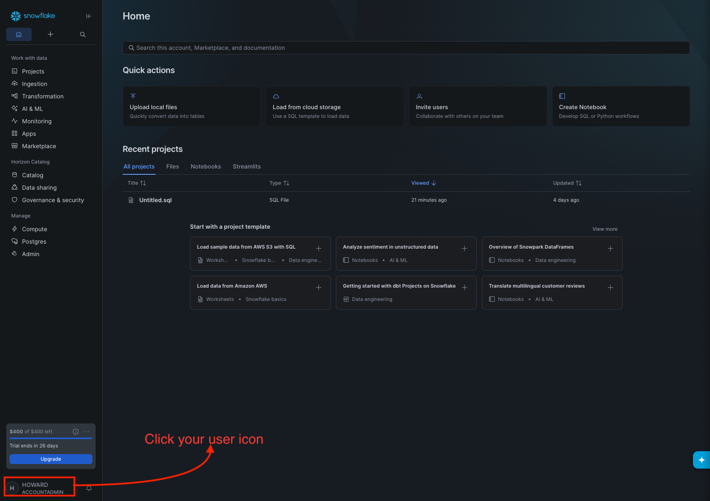
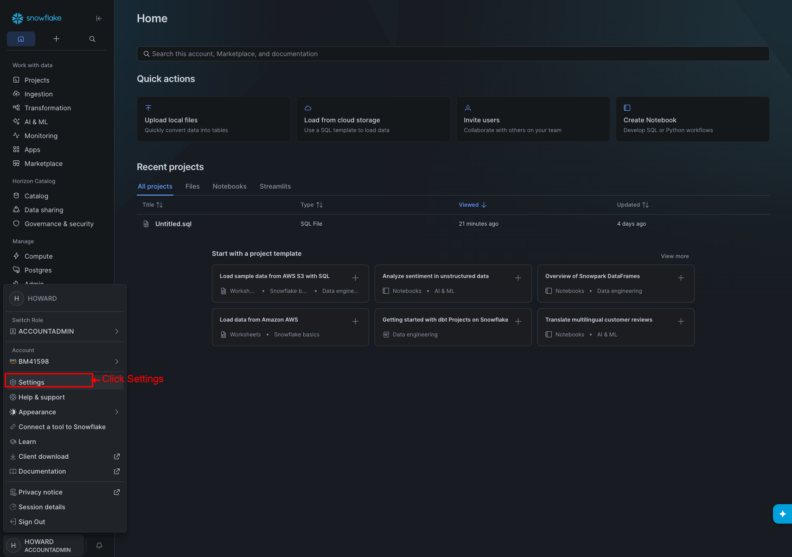
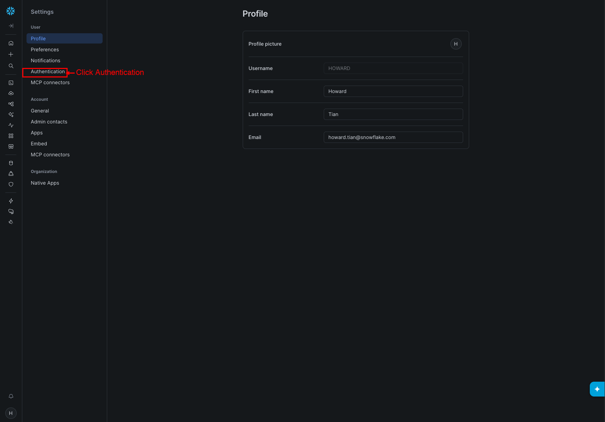
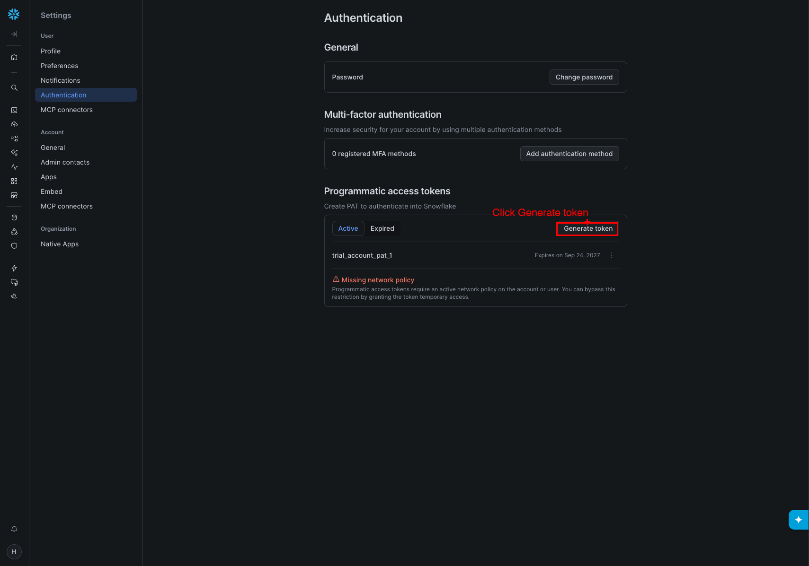
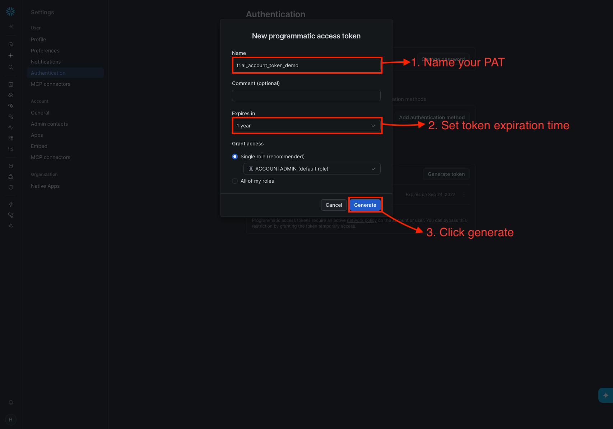
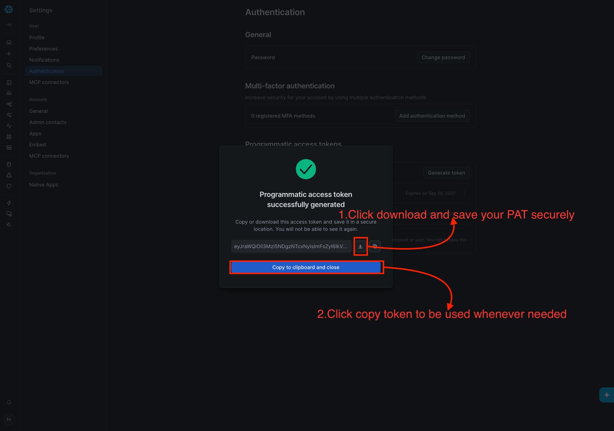
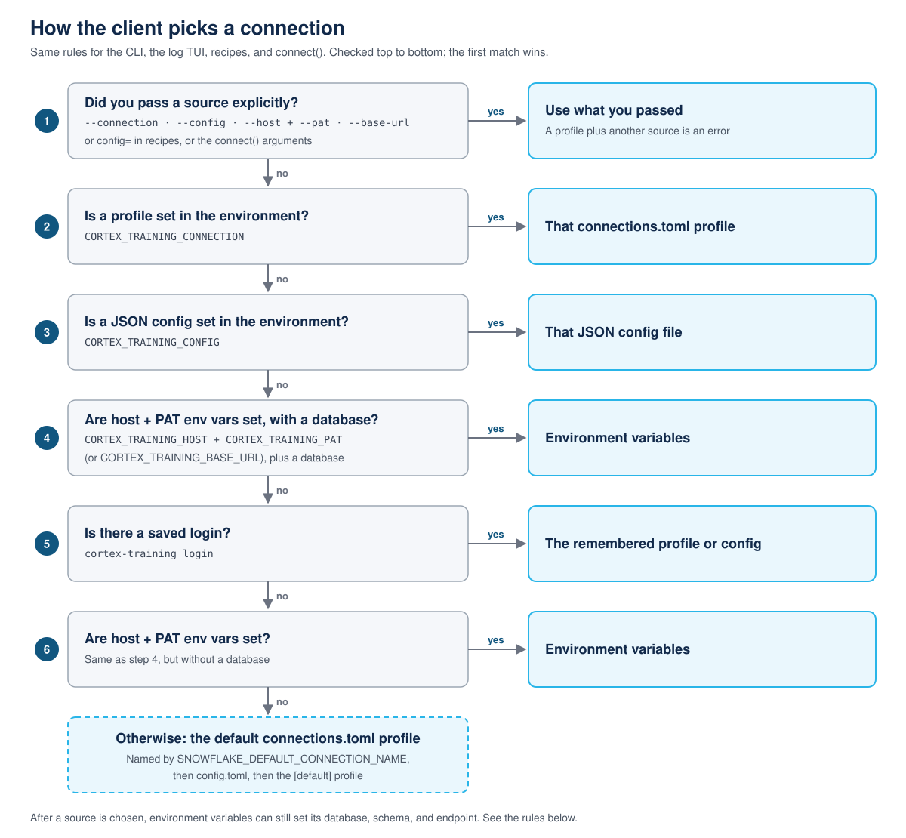

# Authentication

> **You only need to do this once per machine.** After that, the CLI, recipes,
> notebooks, and `connect()` all use the same connection automatically, so no
> command needs connection details. Run `cortex-training login` again when your
> PAT expires or you switch accounts.

Cortex Training authenticates through a Snowflake Programmatic Access Token
(PAT). This page walks you through two steps:

1. **Create a PAT** — required regardless of which configuration method you use
2. **Configure the client** — pick one of the methods below to supply your PAT

The database the client routes requests through (`CORTEX_TRAINING_DB` by
default) is created automatically on first use. If you have more than one
setup, [How the client picks a connection](#how-the-client-picks-a-connection)
explains which one is used.

## Step 1: Create a PAT

> **Heads-up:** By default, Snowflake only accepts a PAT from a user covered by
> a network policy. If Snowsight shows **Missing network policy** on your new
> token, see [Network policy requirement](#network-policy-requirement) before
> you configure the client.

1. Log in to your Snowflake account at `https://<your-account>.snowflakecomputing.com`

2. Click your **user icon** (bottom left)

   

3. Click **Settings**

   

4. Select **Authentication**

   

5. Click **Generate token**

   

6. Give it a name (e.g., `cortex-training`), set an expiry, and click **Generate**

   

7. Copy the token value immediately — you cannot view it again

   

## Step 2: Configure the Client

The fastest way is to let the CLI set it up for you:

```bash
cortex-training login
```

It reports any setup you already have. Otherwise it asks for your account host,
Snowflake user, PAT, database, and schema, writes a `connections.toml` profile,
creates the `CORTEX_TRAINING_DB` database if needed, and checks the connection.
See [`cortex-training login`](../reference/cli.md#login) for details and
scripted use.

To configure the client by hand instead, pick **one** of the following methods.
We recommend `connections.toml`.

### Option A: connections.toml (recommended)

This is Snowflake's standard configuration file, shared across all Snowflake
tools. Create or edit `~/.snowflake/connections.toml`:

```toml
[training]
account = "ORG-ACCOUNT"
host = "ORG-ACCOUNT.snowflakecomputing.com"
user = "YOUR_USERNAME"
authenticator = "programmatic_access_token"
token = "YOUR_PAT"
database = "CORTEX_TRAINING_DB"
schema = "PUBLIC"
```

Protect the file:

```bash
chmod 600 ~/.snowflake/connections.toml
```

#### Finding your account and host

- **account**: your org and account name joined by a hyphen, e.g.,
  `MYORG-MYACCOUNT`. You can find this in your Snowsight URL:
  `https://app.snowflake.com/MYORG/MYACCOUNT` → `MYORG-MYACCOUNT`.
- **host**: `ACCOUNT.snowflakecomputing.com`, e.g.,
  `myorg-myaccount.snowflakecomputing.com`. Use hyphens, not underscores —
  some Snowflake admin tools show underscores but the SSL certificate requires
  hyphens.

#### Setting the default connection

To avoid passing `--connection training` on every command, tell Cortex
Training which profile to use:

```bash
export CORTEX_TRAINING_CONNECTION=training
```

This affects only Cortex Training. The alternatives below change the default
for every Snowflake tool that reads `connections.toml`, such as the Snowflake
CLI and Cortex Code:

- Name the profile `[default]` instead of `[training]`
- `export SNOWFLAKE_DEFAULT_CONNECTION_NAME=training`
- Add `default_connection_name = "training"` to `~/.snowflake/config.toml`

#### Verify

```bash
cortex-training capacity
```

This should print your available GPU capacity. The client automatically creates
the configured database if it does not exist. If automatic creation fails (for
example, your role lacks `CREATE DATABASE`), create it manually in Snowsight:

```sql
CREATE DATABASE IF NOT EXISTS CORTEX_TRAINING_DB;
```

### Option B: JSON config (legacy)

Create a JSON file outside the repository:

```json
{
  "host": "ACCOUNT.snowflakecomputing.com",
  "pat": "YOUR_PAT",
  "database": "CORTEX_TRAINING_DB",
  "schema": "PUBLIC"
}
```

Register it once so subsequent commands use it automatically:

```bash
cortex-training login ~/cortex-training-config.json
cortex-training capacity
```

### Option C: Environment variables

Set credentials directly in your shell:

```bash
export CORTEX_TRAINING_HOST="ACCOUNT.snowflakecomputing.com"
export CORTEX_TRAINING_PAT="YOUR_PAT"
export CORTEX_TRAINING_DATABASE="CORTEX_TRAINING_DB"
export CORTEX_TRAINING_SCHEMA="PUBLIC"
```

Then run commands directly:

```bash
cortex-training capacity
```

This is useful for CI/CD pipelines or when you don't want secrets in files. To
see how environment variables combine with a profile or a JSON config, see
[How the client picks a connection](#how-the-client-picks-a-connection).

Snowflake-prefixed variants (`SNOWFLAKE_PAT`, `SNOWFLAKE_HOST`,
`SNOWFLAKE_DATABASE`, `SNOWFLAKE_SCHEMA`) are also accepted.

## How the client picks a connection

The CLI, the log TUI, recipes, and `connect()` all pick a connection the same
way. The first match wins:



<!-- Diagram: assets/images/connection-picker.svg. Edit the SVG directly; keep text short enough to fit wider fallback fonts. -->

Steps 4 and 6 differ only in whether a database is set: without one, a saved
login (step 5) wins over the environment variables.

Rules worth knowing:

- **What you pass wins over environment variables.** `--config`, or `--host`
  with `--pat`, is used even when `CORTEX_TRAINING_CONNECTION` is set.
- **Environment variables only fill in what the chosen source leaves unset.**
  A JSON config's `database` wins over `CORTEX_TRAINING_DATABASE`, which is
  used only if the file has none. With a profile, `CORTEX_TRAINING_DATABASE`,
  `CORTEX_TRAINING_SCHEMA`, and `CORTEX_TRAINING_ENDPOINT` override the
  profile's values, and `CORTEX_TRAINING_HOST` and `CORTEX_TRAINING_PAT` are
  ignored.
- **A profile can't be combined with another source.** `--connection` together
  with `--config`, `--host`, `--pat`, or `--base-url` is an error, so two
  accounts are never silently mixed.
- **To use a profile for Cortex Training only,** set
  `CORTEX_TRAINING_CONNECTION=NAME`. `SNOWFLAKE_DEFAULT_CONNECTION_NAME` and a
  `[default]` profile change the default for every Snowflake tool.

| Variable | Sets |
|----------|------|
| `CORTEX_TRAINING_CONNECTION` | The `connections.toml` profile to use |
| `CORTEX_TRAINING_CONFIG` | A JSON config file to use |
| `CORTEX_TRAINING_HOST` / `SNOWFLAKE_HOST` | Account host for PAT auth |
| `CORTEX_TRAINING_PAT` / `SNOWFLAKE_PAT` | The PAT |
| `CORTEX_TRAINING_BASE_URL` | A local or mock server (no auth) |
| `CORTEX_TRAINING_DATABASE` / `SNOWFLAKE_DATABASE` | Database for API routing |
| `CORTEX_TRAINING_SCHEMA` / `SNOWFLAKE_SCHEMA` | Schema for API routing |
| `CORTEX_TRAINING_ENDPOINT` | REST endpoint name |

## Troubleshooting

| Error | Cause | Fix |
|-------|-------|-----|
| `SSL certificate verify failed` | Underscores in hostname | Replace underscores with hyphens in `host` |
| `Default connection with name 'default' cannot be found` | No connection is configured | Follow [Step 2](#step-2-configure-the-client) |
| `host was provided without pat`, or `... has no pat` | Only part of a direct connection is set | Set both host and PAT (`CORTEX_TRAINING_HOST` and `CORTEX_TRAINING_PAT`, or `host` and `pat` in the JSON config), or use a `connections.toml` profile |
| `401 Unauthorized` | PAT expired, invalid, or your user has no network policy | See [Network policy requirement](#network-policy-requirement), or regenerate the PAT |
| `401 Unauthorized` or `Programmatic access token is invalid`, after it used to work | The PAT expired or was replaced | Create a new PAT ([Step 1](#step-1-create-a-pat)) and update it in your setup |
| `394400 (08001)` / `Programmatic access token is invalid` | Your user has no network policy, or the PAT is wrong | See [Network policy requirement](#network-policy-requirement) |

### Network policy requirement

By default, Snowflake only accepts a PAT from a user covered by a
[network policy](https://docs.snowflake.com/en/user-guide/network-policies),
a list of IP addresses allowed to sign in. You can create a PAT without one,
but Snowflake then rejects it with `Programmatic access token is invalid` (or
`401 Unauthorized`). In Snowsight, the token shows **Missing network policy**
under **Settings → Authentication**.

#### 1. Confirm the cause (one minute)

1. In Snowsight, open **Settings → Authentication**.
2. On your token, open the **⋯** menu and choose **Bypass requirement for
   network policy**.
3. Run `cortex-training capacity` again.

If it now works, the network policy is the cause. The bypass is temporary, so
continue with step 2.

#### 2. Fix it permanently

An account administrator (`ACCOUNTADMIN` or `SECURITYADMIN`) picks one of these
options:

| Option | Best when | Trade-off |
|--------|-----------|-----------|
| **A. Network policy** | You connect from fixed IP addresses (office, VPN, cloud VM) | Must be updated whenever your IP changes |
| **B. Authentication policy** | Your IP changes (home network, laptop on the go) | The PAT works from any IP, so keep it secret |

**Option A: allow your IP addresses with a network policy**

```sql
USE ROLE ACCOUNTADMIN;

CREATE NETWORK POLICY CORTEX_TRAINING_ACCESS
  ALLOWED_IP_LIST = ('<cli-machine-ip>', '<snowsight-ip>');

ALTER USER <your-username> SET NETWORK_POLICY = CORTEX_TRAINING_ACCESS;
```

- `<cli-machine-ip>` is the public IP of the machine that runs
  `cortex-training`. Get it on that machine with `curl -s https://ifconfig.me`.
- `<snowsight-ip>` is the IP you open Snowsight from. Include it so the policy
  doesn't lock you out of Snowsight.

The policy pins you to those IP addresses, for Snowsight logins too. If your
public IP changes, which is common on home networks without a VPN, logins fail
again until an administrator updates the list from an IP that is still allowed:

```sql
ALTER NETWORK POLICY CORTEX_TRAINING_ACCESS
  SET ALLOWED_IP_LIST = ('<new-cli-machine-ip>', '<snowsight-ip>');
```

**Option B: drop the network-policy requirement for PATs with an authentication policy**

```sql
USE ROLE ACCOUNTADMIN;

CREATE DATABASE IF NOT EXISTS CORTEX_TRAINING_DB;

CREATE AUTHENTICATION POLICY CORTEX_TRAINING_DB.PUBLIC.CORTEX_TRAINING_PAT_POLICY
  PAT_POLICY = (NETWORK_POLICY_EVALUATION = ENFORCED_NOT_REQUIRED);

ALTER USER <your-username>
  SET AUTHENTICATION POLICY CORTEX_TRAINING_DB.PUBLIC.CORTEX_TRAINING_PAT_POLICY;
```

`ENFORCED_NOT_REQUIRED` means your user no longer needs a network policy to
use a PAT, but any network policy that does apply is still enforced.

If your account or user already has an authentication policy (for example, one
that requires MFA), don't create a new one: a user-level policy replaces the
account-level policy for that user, which can drop those other settings. Add
the `PAT_POLICY` setting to the existing policy instead. See Snowflake's
[programmatic access token documentation](https://docs.snowflake.com/en/user-guide/programmatic-access-tokens#network-policy-requirements).

#### Still failing?

If Snowsight shows no network policy warning, or the bypass didn't help:

- Generate a new PAT and paste it without extra spaces or quotes.
- Check that `user` in your connection config is the user who owns the token.
