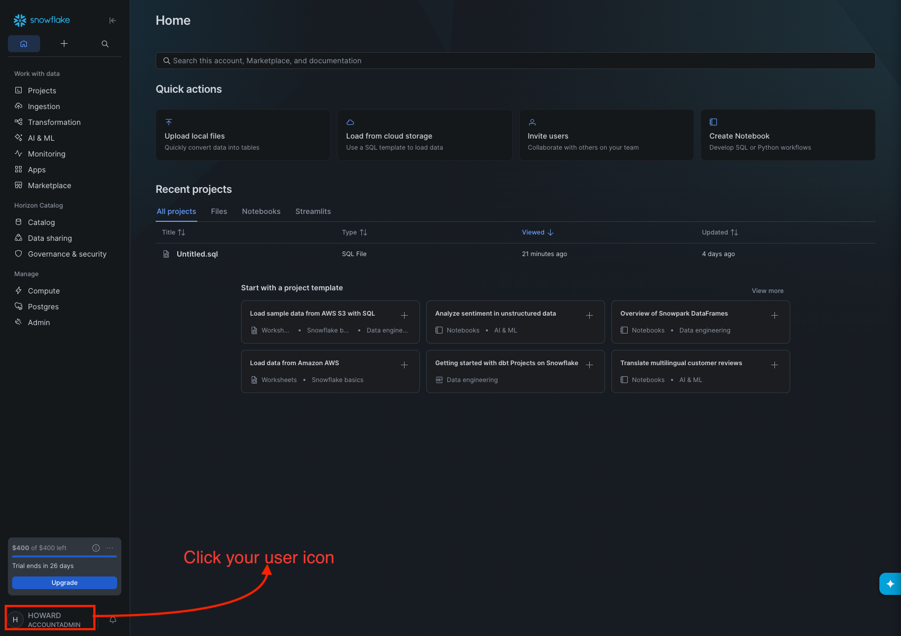
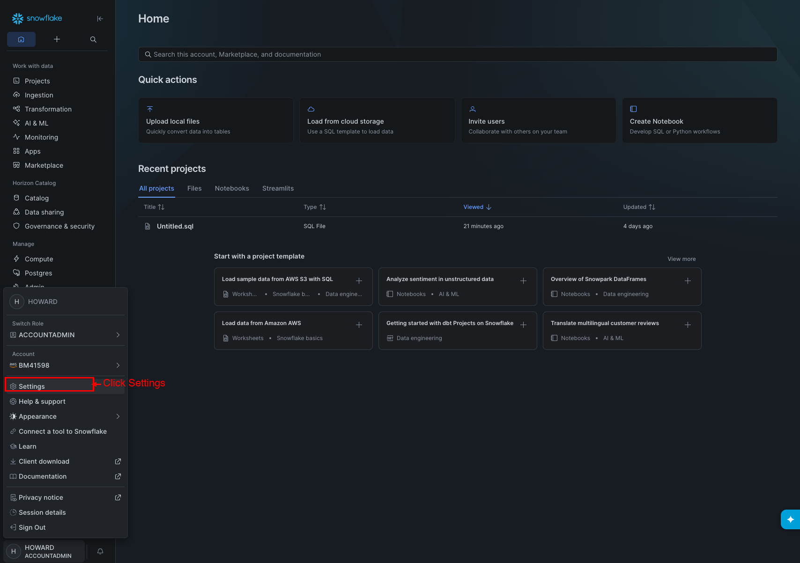
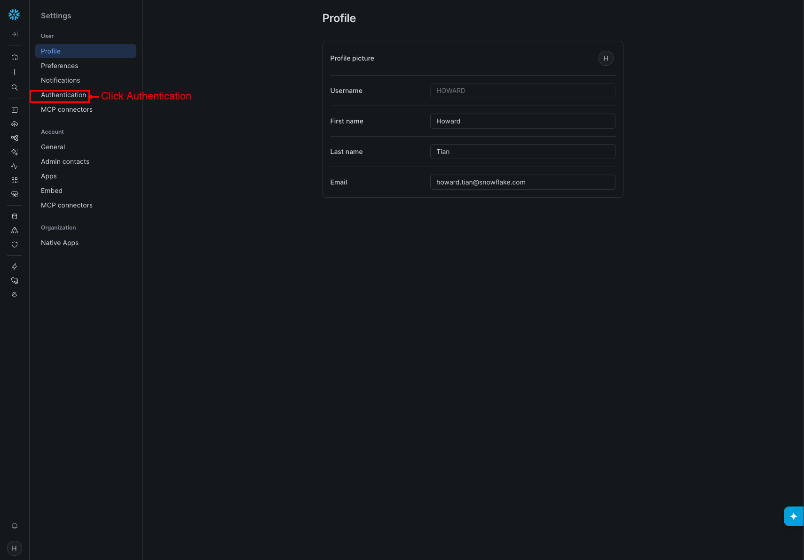
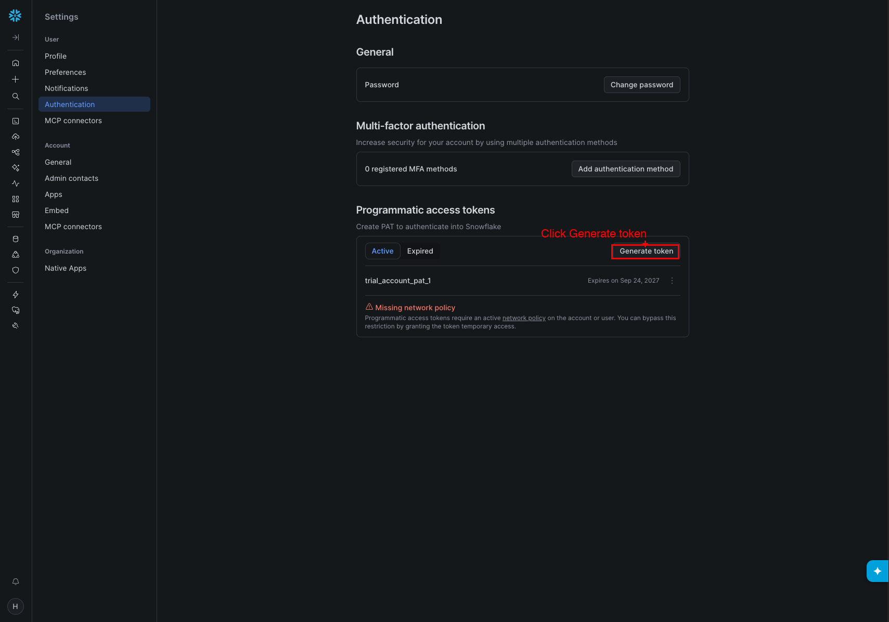
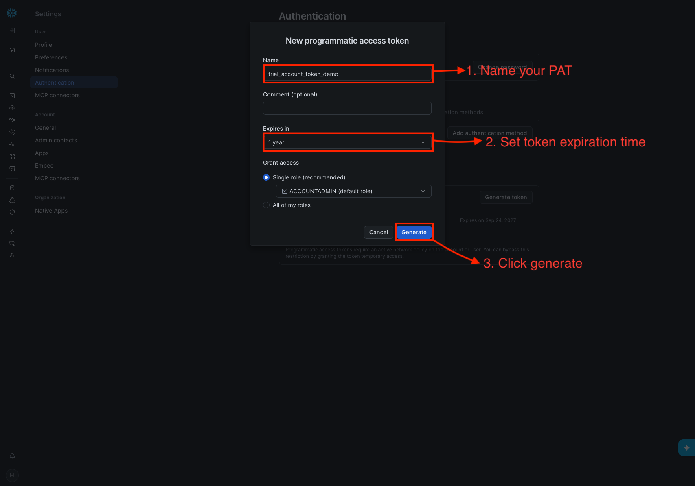
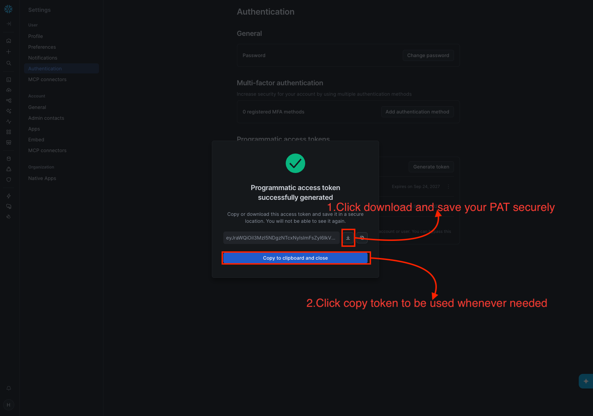

# Authentication

Cortex Training authenticates through a Snowflake Programmatic Access Token
(PAT). This page walks you through three steps:

1. **Create a PAT** — required regardless of which configuration method you use
2. **Create the database** — one-time setup for the connection config
3. **Configure the client** — pick one of the methods below to supply your PAT

## Step 1: Create a PAT

> **Heads-up:** By default, Snowflake only accepts a PAT from a user covered by
> a network policy. If Snowsight shows **Missing network policy** on your new
> token, see [Network policy requirement](#network-policy-requirement) before
> you configure the client.

1. Log in to your Snowflake account at `https://<your-account>.snowflakecomputing.com`

2. Click your **user icon** (bottom left)

   

3. Click **Settings**

   

4. Select **Authentication**

   

5. Click **Generate token**

   

6. Give it a name (e.g., `cortex-training`), set an expiry, and click **Generate**

   

7. Copy the token value immediately — you cannot view it again

   

## Step 2: Configure the Client

Once you have a PAT, pick **one** of the following methods to configure the
client. We recommend `connections.toml`.

### Option A: a connection profile (recommended)

A Snowflake connection profile is Snowflake's standard configuration, shared
across all Snowflake tools. The easiest way to set one up is to run:

```bash
cortex-training login
```

It asks for the account, user, role and PAT, checks that the profile connects
to Cortex Training, and saves it as the one to use. It prints the files it
writes.

To write the profile yourself instead, add it to `connections.toml` in your
[Snowflake folder](#the-snowflake-folder), usually
`~/.snowflake/connections.toml`:

```toml
[cortex-training]
account = "ORG-ACCOUNT"
host = "ACCOUNT.snowflakecomputing.com"
user = "YOUR_USERNAME"
role = "YOUR_ROLE"
authenticator = "PROGRAMMATIC_ACCESS_TOKEN"
token = "YOUR_PAT"
database = "CORTEX_TRAINING_DB"
schema = "PUBLIC"
```

Protect the file, then check the profile and save it as the one to use:

```bash
chmod 600 ~/.snowflake/connections.toml
cortex-training login cortex-training
```

#### The Snowflake folder

Snowflake tools look for `connections.toml` in `$SNOWFLAKE_HOME` if it's set,
else in `~/.snowflake` if that folder exists, else in a platform folder:
`~/Library/Application Support/snowflake` on macOS, `~/.config/snowflake` on
Linux. `cortex-training login` uses the same rule, and prints the file it uses.

Write a profile by hand to that same file. In particular, if `login` saved your
profile in the platform folder, don't create `~/.snowflake` afterwards: Snowflake
tools would then look there instead, and your saved profile would no longer be
found.

#### Finding your account and host

- **account**: your org and account name joined by a hyphen, e.g.,
  `MYORG-MYACCOUNT`. You can find this in your Snowsight URL:
  `https://app.snowflake.com/MYORG/MYACCOUNT` → `MYORG-MYACCOUNT`.
- **host**: `ACCOUNT.snowflakecomputing.com`, e.g.,
  `myorg-myaccount.snowflakecomputing.com`. Snowsight may show an account name
  with an underscore (`my_acct.…`). Snowflake's certificates are wildcards
  (for example, `*.snowflakecomputing.com`), and a wildcard can't match a name
  containing `_`, so the client uses the hyphen form (`my-acct.…`) for its own
  HTTPS calls. Either form works in your profile.

#### Setting the default connection

`cortex-training login NAME` saves the profile as the one Cortex Training uses
(in `cortex-training/config.json` in the Snowflake folder), so commands, the
TUI, and the recipes use it without `--connection`. With no saved choice, they
use Snowflake's default profile, which you can set with any of these methods:

- Name the profile `[default]` instead of `[cortex-training]`
- Set the environment variable:
  ```bash
  export SNOWFLAKE_DEFAULT_CONNECTION_NAME=cortex-training
  ```
- Add `default_connection_name = "cortex-training"` to `config.toml` in the
  Snowflake folder

#### Verify

```bash
cortex-training capacity
```

This should print your available GPU capacity.

Cortex Training keeps your jobs and checkpoints in the profile's database.
Commands never create it on their own. `cortex-training login` checks it, and
if it's missing, shows the `CREATE DATABASE` statement and runs it only if you
say yes. Or create it once, in Snowsight:

```sql
CREATE DATABASE IF NOT EXISTS CORTEX_TRAINING_DB;
```

If a command can't find the database, it stops with an error that names your
role and the database, and how to fix it: create it, ask an admin for
`GRANT USAGE`, or use another database with `--database`.

### Option B: Environment variables (CI)

For CI and other places without a profile, set credentials in the environment:

```bash
export CORTEX_TRAINING_HOST="ACCOUNT.snowflakecomputing.com"
export CORTEX_TRAINING_PAT="YOUR_PAT"
export CORTEX_TRAINING_DATABASE="CORTEX_TRAINING_DB"
export CORTEX_TRAINING_SCHEMA="PUBLIC"
```

Then run commands directly:

```bash
cortex-training capacity
```

`CORTEX_TRAINING_HOST` and `CORTEX_TRAINING_PAT` are used only on machines with
no profile. If you also have a profile, the profile is used, and the command
warns that they're ignored. `CORTEX_TRAINING_DATABASE` and
`CORTEX_TRAINING_SCHEMA` choose the database and schema with any connection.

Use the `CORTEX_TRAINING_` names: the older `SNOWFLAKE_`-prefixed ones are
ignored, with a warning.

## Old users who log in with a JSON connection file

If you log in with a JSON config file (`host`, `pat`, `database`, `schema`),
one command turns it into a Snowflake connection profile:

```bash
cortex-training login --convert-legacy-config ~/cortex-training-config.json
```

It shows what the file holds (the PAT stays hidden). A `host`, `pat`,
`database`, or `schema` the file leaves out comes from the environment variables
the old CLI read (`CORTEX_TRAINING_*`, then `SNOWFLAKE_*`), and it shows which.
Then it asks before each step:

1. **It checks the PAT.** It signs in with it to look up your user and role, to
   check that Cortex Training answers for the account, and to check the database. This only
   reads. If the database is missing, it shows the `CREATE DATABASE` statement
   and runs it only if you say yes. If a check fails, it says why and changes
   nothing.
2. **It shows every change and asks once.** It never deletes or edits the old
   file. The changes are:
   - adding the profile (named `cortex-training`, or the next free name);
   - saving it as `"profile"` in `cortex-training/config.json` in the Snowflake
     folder.
     That file holds only the profile, so the old file's `endpoint`,
     `poll_interval`, `poll_timeout`, and `verify_ssl` aren't kept; the converter
     lists any that differ from the defaults, with the flags that set them
     (`--no-verify-ssl` for `verify_ssl: false`);
   - signing in with the new profile, to check that it works.

Either every change happens, or every file is put back as it was.

**After converting.** The old file is kept exactly as it was, and `login.json`
is left alone, but commands no longer read either: they use the profile.
Recipes still accept `config=FILE`, with a warning. To undo the conversion,
remove `"profile"` from `cortex-training/config.json` in your Snowflake folder
(`$SNOWFLAKE_HOME`, `~/.snowflake`, or the platform folder; the converter prints
the exact path), and delete the profile from `connections.toml`.

Until you convert, a command that would sign in with the file (`--config FILE`,
`CORTEX_TRAINING_CONFIG`, or `login.json`) stops before it connects. In a
terminal it offers to convert the file then and there; otherwise it prints the
command above. See
[Converting An Older Connection](../reference/cli.md#converting-an-older-connection).

## Troubleshooting

| Error | Cause | Fix |
|-------|-------|-----|
| `SSL certificate verify failed` | The `host` is not a `snowflakecomputing.com` address and has an underscore (for example, a custom name such as `ml_team.example.com`), or a company network tool that inspects HTTPS traffic replaces Snowflake's certificate with its own | Use the hyphen form (`ml-team.example.com`), or ask IT for the company certificate file and set `REQUESTS_CA_BUNDLE=/path/to/company-ca.pem` |
| `Failed to resolve` / `NameResolutionError` for a `…privatelink.snowflakecomputing.com` host with a `-` where your account name has a `_` | With PrivateLink, the client calls the hyphen form of your account host (see the host note above), and your private DNS may only have a record for the underscore form | Ask your network admin to add a DNS record for the hyphen form. `SYSTEM$GET_PRIVATELINK_CONFIG()` lists the hyphenated URLs (for example, `privatelink-dashed-urls-for-duo`) |
| `no PAT found` | Missing token in config | Add `token` to connections.toml, `pat` to JSON, or set `CORTEX_TRAINING_PAT` |
| `401 Unauthorized` | PAT expired, invalid, or your user has no network policy | See [Network policy requirement](#network-policy-requirement), or regenerate the PAT |
| `394400 (08001)` / `Programmatic access token is invalid` | Your user has no network policy, or the PAT is wrong | See [Network policy requirement](#network-policy-requirement) |

### Network policy requirement

By default, Snowflake only accepts a PAT from a user covered by a
[network policy](https://docs.snowflake.com/en/user-guide/network-policies),
a list of IP addresses allowed to sign in. You can create a PAT without one,
but Snowflake then rejects it with `Programmatic access token is invalid` (or
`401 Unauthorized`). In Snowsight, the token shows **Missing network policy**
under **Settings → Authentication**.

#### 1. Confirm the cause (one minute)

1. In Snowsight, open **Settings → Authentication**.
2. On your token, open the **⋯** menu and choose **Bypass requirement for
   network policy**.
3. Run `cortex-training capacity` again.

If it now works, the network policy is the cause. The bypass is temporary, so
continue with step 2.

#### 2. Fix it permanently

An account administrator (`ACCOUNTADMIN` or `SECURITYADMIN`) picks one of these
options:

| Option | Best when | Trade-off |
|--------|-----------|-----------|
| **A. Network policy** | You connect from fixed IP addresses (office, VPN, cloud VM) | Must be updated whenever your IP changes |
| **B. Authentication policy** | Your IP changes (home network, laptop on the go) | The PAT works from any IP, so keep it secret |

**Option A: allow your IP addresses with a network policy**

```sql
USE ROLE ACCOUNTADMIN;

CREATE NETWORK POLICY CORTEX_TRAINING_ACCESS
  ALLOWED_IP_LIST = ('<cli-machine-ip>', '<snowsight-ip>');

ALTER USER <your-username> SET NETWORK_POLICY = CORTEX_TRAINING_ACCESS;
```

- `<cli-machine-ip>` is the public IP of the machine that runs
  `cortex-training`. Get it on that machine with `curl -s https://ifconfig.me`.
- `<snowsight-ip>` is the IP you open Snowsight from. Include it so the policy
  doesn't lock you out of Snowsight.

The policy pins you to those IP addresses, for Snowsight logins too. If your
public IP changes, which is common on home networks without a VPN, logins fail
again until an administrator updates the list from an IP that is still allowed:

```sql
ALTER NETWORK POLICY CORTEX_TRAINING_ACCESS
  SET ALLOWED_IP_LIST = ('<new-cli-machine-ip>', '<snowsight-ip>');
```

**Option B: drop the network-policy requirement for PATs with an authentication policy**

```sql
USE ROLE ACCOUNTADMIN;

CREATE DATABASE IF NOT EXISTS CORTEX_TRAINING_DB;

CREATE AUTHENTICATION POLICY CORTEX_TRAINING_DB.PUBLIC.CORTEX_TRAINING_PAT_POLICY
  PAT_POLICY = (NETWORK_POLICY_EVALUATION = ENFORCED_NOT_REQUIRED);

ALTER USER <your-username>
  SET AUTHENTICATION POLICY CORTEX_TRAINING_DB.PUBLIC.CORTEX_TRAINING_PAT_POLICY;
```

`ENFORCED_NOT_REQUIRED` means your user no longer needs a network policy to
use a PAT, but any network policy that does apply is still enforced.

If your account or user already has an authentication policy (for example, one
that requires MFA), don't create a new one: a user-level policy replaces the
account-level policy for that user, which can drop those other settings. Add
the `PAT_POLICY` setting to the existing policy instead. See Snowflake's
[programmatic access token documentation](https://docs.snowflake.com/en/user-guide/programmatic-access-tokens#network-policy-requirements).

#### Still failing?

If Snowsight shows no network policy warning, or the bypass didn't help:

- Generate a new PAT and paste it without extra spaces or quotes.
- Check that `user` in your connection config is the user who owns the token.
